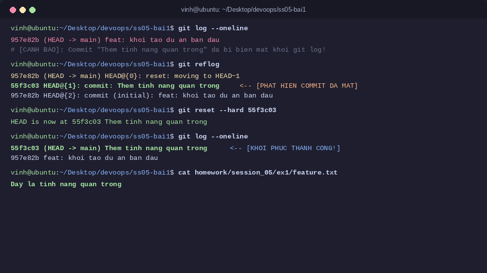

# Bài 1: Khôi phục commit đã mất bằng Git Reflog

## Thông tin bài tập
- **Học viên:** Vinh Nguyen
- **Môn học:** DevOps (IT209) - Session 05
- **Đường dẫn nộp bài trên GitHub:** `homework/session_05/ex1/`
- **Kho lưu trữ GitHub:** [QuangVinh1605/IT209-SS05-BAI1](https://github.com/QuangVinh1605/IT209-SS05-BAI1)

---

## 1. Mục tiêu bài thực hành
1. **Hiểu rõ cơ chế Reflog:** Nắm vững cách Git ghi nhận và duy trì nhật ký hoạt động của các con trỏ tham chiếu (`HEAD` và nhánh) ở cấp độ repository cục bộ.
2. **Thành thạo truy vết commit cũ:** Sử dụng thành thạo lệnh `git reflog` để tìm lại dấu vết của các commit đã bị tách rời (detached/dangling commits) khỏi cây lịch sử chính.
3. **Cứu dữ liệu an toàn:** Khôi phục thành công commit quan trọng bị xóa mất sau thao tác nhầm lẫn `git reset --hard` mà không cần viết lại mã nguồn thủ công.

---

## 2. Bối cảnh & Tình huống sự cố

Trong quá trình phát triển dự án, học viên hoàn thành một tính năng quan trọng và lưu lại bằng commit:
```text
55f3c03 (HEAD -> main) Them tinh nang quan trong
```
Tệp tin `feature.txt` chứa mã nguồn quan trọng:
```text
Day la tinh nang quan trong
```

Tuy nhiên, do sơ suất trong quá trình thao tác lệnh, học viên vô tình chạy lệnh:
```bash
git reset --hard HEAD~1
```

**Hậu quả tức thì:**
- Con trỏ `HEAD` và nhánh `main` bị kéo lùi về commit trước đó (`957e82b feat: khoi tao du an ban dau`).
- Vùng Staging Area bị dọn sạch.
- Toàn bộ thay đổi trong Working Directory bị hủy bỏ: Tệp tin `feature.txt` biến mất hoàn toàn trên ổ đĩa.
- Khi kiểm tra bằng `git log --oneline`, commit `55f3c03` hoàn toàn không còn xuất hiện trong cây lịch sử.

---

## 3. Các bước thực hiện xử lý & Khôi phục

### Bước 1: Khởi tạo và ghi nhận tính năng quan trọng
Tạo tệp mã nguồn `feature.txt` và đóng gói thành commit trên nhánh `main`:
```bash
echo "Day la tinh nang quan trong" > homework/session_05/ex1/feature.txt
git add .
git commit -m "Them tinh nang quan trong"
```

Kiểm tra lịch sử commit:
```bash
git log --oneline
```
*Kết quả:*
```text
55f3c03 (HEAD -> main) Them tinh nang quan trong
957e82b feat: khoi tao du an ban dau
```

---

### Bước 2: Giả lập sự cố mất commit bằng `git reset --hard`
Học viên thực thi lệnh reset mức độ hard:
```bash
git reset --hard HEAD~1
```
*Thông báo từ Git:*
```text
HEAD is now at 957e82b feat: khoi tao du an ban dau
```

---

### Bước 3: Xác nhận sự cố và đánh giá thiệt hại
Chạy lệnh kiểm tra commit và tệp tin:
```bash
git log --oneline
ls -la homework/session_05/ex1/
```
*Kết quả ghi nhận:*
- Lệnh `git log --oneline` chỉ còn hiển thị duy nhất commit ban đầu:
  ```text
  957e82b (HEAD -> main) feat: khoi tao du an ban dau
  ```
- Thư mục `homework/session_05/ex1/` không còn tệp `feature.txt`.
- Nếu chỉ dựa vào `git log`, người dùng sẽ lầm tưởng rằng commit và dữ liệu đã bị xóa vĩnh viễn khỏi Git.

---

### Bước 4: Truy vết mã Hash bằng `git reflog`
Do Git luôn duy trì nhật ký tham chiếu cục bộ (`Reference Logs`), mọi chuyển động của con trỏ `HEAD` đều được ghi lại độc lập với cây commit chính:
```bash
git reflog
```

*Nhật ký Reflog hiển thị:*
```text
957e82b (HEAD -> main) HEAD@{0}: reset: moving to HEAD~1
55f3c03 HEAD@{1}: commit: Them tinh nang quan trong
957e82b (HEAD -> main) HEAD@{2}: commit (initial): feat: khoi tao du an ban dau
```

**Phân tích nhật ký:**
- Dòng `HEAD@{0}`: Thể hiện thao tác gần nhất là lệnh `reset: moving to HEAD~1`, đưa `HEAD` về `957e82b`.
- Dòng `HEAD@{1}`: Thể hiện vị trí ngay trước đó của `HEAD` chính là commit `55f3c03` với thông điệp `"Them tinh nang quan trong"`.
- Mã hash cần khôi phục đã được xác định chính xác: **`55f3c03`** (hoặc tham chiếu `HEAD@{1}`).

---

### Bước 5: Tiến hành khôi phục commit

#### Cách 1: Sử dụng `git reset --hard` đưa nhánh hiện tại về vị trí cũ (Phương pháp trực tiếp)
```bash
git reset --hard 55f3c03
# Hoặc có thể sử dụng cú pháp: git reset --hard HEAD@{1}
```
*Kết quả:*
```text
HEAD is now at 55f3c03 Them tinh nang quan trong
```

#### Cách 2: Tạo nhánh mới trỏ vào commit đã mất (Phương pháp an toàn trong dự án lớn)
Nếu không muốn can thiệp trực tiếp vào nhánh hiện tại, kỹ sư có thể tạo một nhánh cứu hộ từ mã hash vừa tìm được:
```bash
git branch rescue-feature 55f3c03
git checkout rescue-feature
```

---

### Bước 6: Kiểm tra và xác nhận kết quả khôi phục

1. **Kiểm tra lịch sử commit:**
   ```bash
   git log --oneline
   ```
   *Kết quả:*
   ```text
   55f3c03 (HEAD -> main) Them tinh nang quan trong
   957e82b feat: khoi tao du an ban dau
   ```
   $\rightarrow$ Commit `55f3c03` đã quay trở lại đỉnh nhánh `main`.

2. **Kiểm tra nội dung tệp tin phục hồi:**
   ```bash
   cat homework/session_05/ex1/feature.txt
   ```
   *Kết quả:*
   ```text
   Day la tinh nang quan trong
   ```
   $\rightarrow$ Toàn bộ mã nguồn đã được khôi phục nguyên vẹn 100% mà không cần viết lại bất kỳ dòng code nào.

3. **Kiểm tra lại `git reflog` sau khi khôi phục:**
   ```bash
   git reflog
   ```
   *Kết quả:*
   ```text
   55f3c03 (HEAD -> main) HEAD@{0}: reset: moving to 55f3c03
   957e82b HEAD@{1}: reset: moving to HEAD~1
   55f3c03 (HEAD -> main) HEAD@{2}: commit: Them tinh nang quan trong
   957e82b HEAD@{3}: commit (initial): feat: khoi tao du an ban dau
   ```

---

## 4. Phân tích chuyên sâu: Cơ chế hoạt động của Git Reflog

### 4.1. Reflog là gì?
- **Reflog (Reference Log):** Là cơ chế ghi lại nhật ký thay đổi của các con trỏ tham chiếu cục bộ trong Git (chẳng hạn như `HEAD`, `refs/heads/main`, `refs/stash`).
- Dữ liệu Reflog được lưu trữ vật lý tại thư mục `.git/logs/` (ví dụ: `.git/logs/HEAD`).
- Reflog chỉ tồn tại trên **môi trường cục bộ (Local)** của từng máy phát triển, không bao giờ được chia sẻ hay đẩy lên Remote khi chạy `git push`.

### 4.2. So sánh `git log` vs `git reflog`

| Tiêu chí | `git log` | `git reflog` |
| :--- | :--- | :--- |
| **Bản chất** | Duyệt theo đồ thị các commit (Commit Graph) từ commit hiện tại ngược về gốc. | Ghi nhật ký trình tự thời gian mọi thao tác di chuyển con trỏ `HEAD` trên máy local. |
| **Phạm vi hiển thị** | Chỉ hiển thị các commit có đường dẫn kết nối tới nhánh hiện tại (Reachable commits). | Hiển thị tất cả mọi hành động: commit, checkout, reset, merge, rebase, cherry-pick,... |
| **Khả năng thấy commit mất** | **Không:** Các commit bị reset/mất nhánh sẽ biến mất khỏi danh sách. | **Có:** Thấy được mã hash của commit ngay cả khi nó không còn thuộc nhánh nào. |
| **Tính chất phạm vi** | Được đồng bộ và chia sẻ qua Remote Repository. | Chỉ lưu cục bộ trên máy cá nhân, mang tính riêng tư. |

### 4.3. Tại sao `git reset --hard` không làm mất dữ liệu ngay lập tức?
1. **Kiến trúc Append-only của Git:** Khi một commit được tạo ra, Git lưu các đối tượng blob, tree và commit object vào `.git/objects/`.
2. Khi chạy `git reset --hard HEAD~1`, Git chỉ thay đổi vị trí con trỏ nhánh `main` để trỏ vào commit cha. Bản thân commit `55f3c03` không bị xóa vật lý ngay lập tức, mà trở thành một **Dangling Commit** (commit mồ côi / không có ref nào trỏ tới).
3. **Cơ chế Garbage Collection (`git gc`):**
   - Các dangling commit được bảo vệ bởi Reflog trong một khoảng thời gian hết hạn (mặc định là **30 ngày** đối với unreachable objects và **90 ngày** đối với reachable objects).
   - Chỉ khi tiến trình `git gc --prune=now` được kích hoạt thủ công hoặc khi hết hạn lưu trữ, Git mới dọn dẹp vật lý các đối tượng này để giải phóng dung lượng ổ đĩa.
   - Nhờ cơ chế này, kỹ sư luôn có cơ hội "cứu mạng" dữ liệu đã lỡ xóa bằng `git reflog`.

---

## 5. Hình ảnh minh chứng Terminal

Dưới đây là ảnh chụp màn hình ghi nhận toàn bộ quá trình phát hiện sự cố, tra cứu qua `git reflog`, thực hiện lệnh `git reset --hard <hash>` và kiểm tra kết quả khôi phục:


